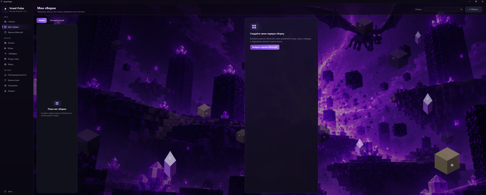
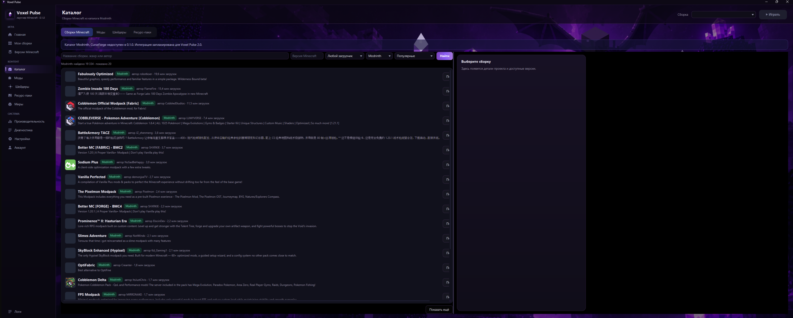
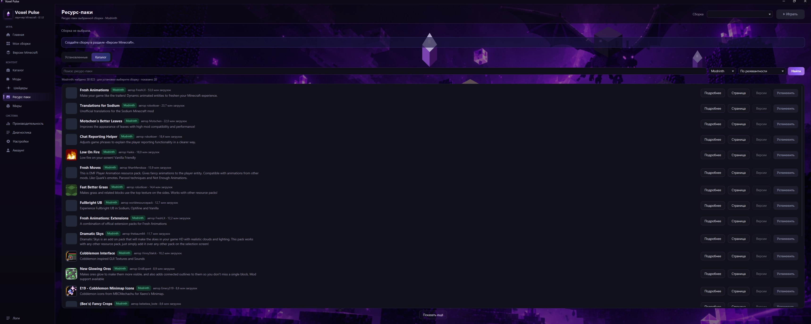
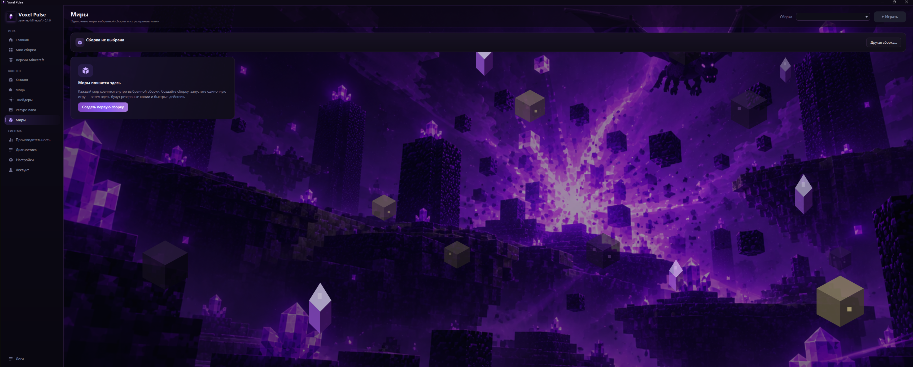
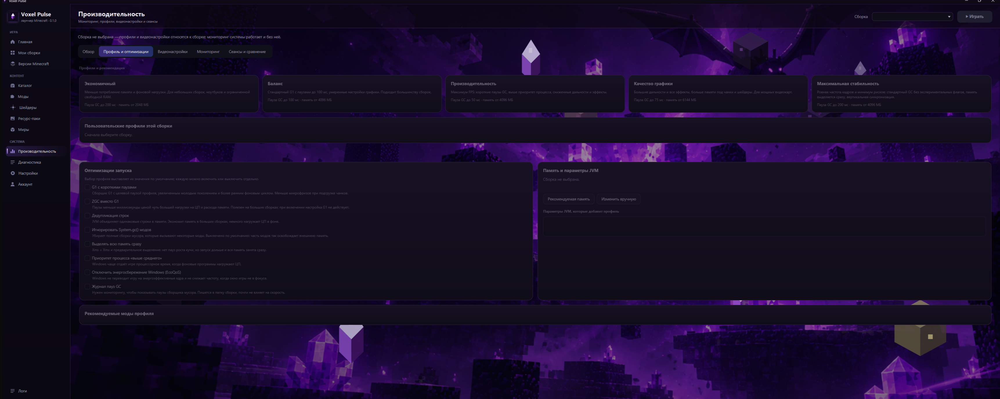
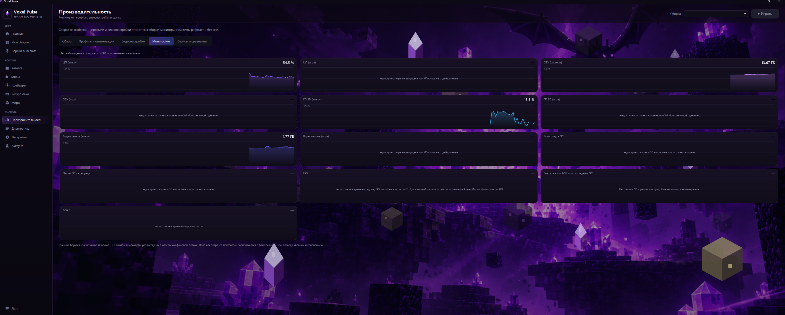
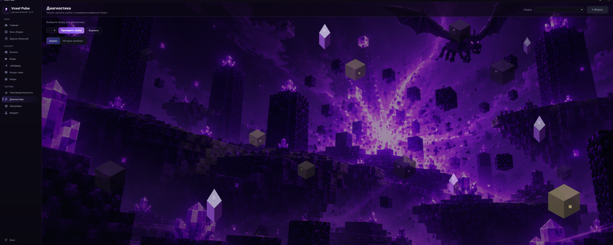
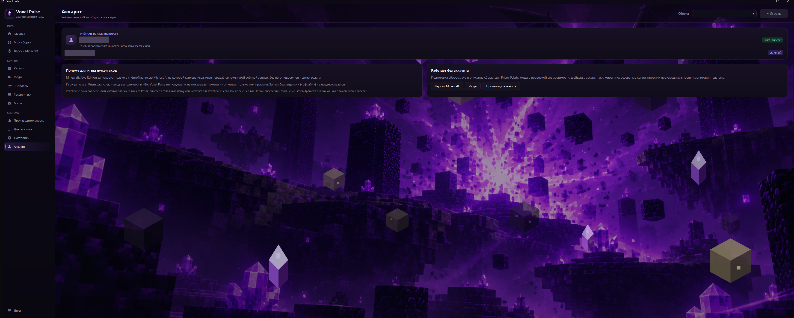

# Voxel Pulse

Independent Minecraft Java Edition launcher and modpack manager with a custom runtime.

Voxel Pulse is an independent desktop launcher designed to simplify Minecraft installation, modpack management, runtime configuration, and performance optimization.

## Project Status

**Currently in active development.**

## Interface Gallery

Select a screenshot to open the original resolution.

### Instances & Content

| Instance Manager | Modrinth Catalog |
| --- | --- |
|  |  |
| Start with a Minecraft version or import a local `.mrpack`. | Filter modpacks by Minecraft version and loader, then select a project to see its available versions. |

| Resource Packs | Worlds |
| --- | --- |
|  |  |
| Search Modrinth for resource packs or switch to the packs installed in an instance. | Each instance has its own single-player worlds and backups. This view shows where to start before an instance exists. |

### Performance & Support

| Performance Profiles | Performance Monitoring |
| --- | --- |
|  |  |
| Compare five presets, from power saving to maximum stability, and review their memory and JVM settings. | Follow system CPU, GPU and memory usage. No game process is being monitored in this capture. |

| Diagnostics | Account |
| --- | --- |
|  |  |
| Select an instance to check for launch issues, inspect logs or revisit earlier findings. | See which account Prism Launcher uses for play and which launcher features work without signing in. |

## Current Features

- Custom BUILTIN Minecraft installation engine
- Vanilla Minecraft support
- Fabric Loader support
- Minecraft 26.3 runtime preparation
- Automatic Java 25 runtime installation
- Modrinth integration
- Local .mrpack modpack installation
- Game file integrity verification
- Instance management
- Transactional installation and recovery
- Backup management
- JavaFX graphical user interface
- Command-line interface
- Alternative PrismLauncher integration

## Authentication

Voxel Pulse is designed to use official Microsoft account authentication through Microsoft's OAuth device code flow.

Minecraft API approval is pending. It is required to complete live authentication and game launch testing.

The application does not directly collect Microsoft account passwords and is not intended to bypass Minecraft ownership verification.

## Development Roadmap

- Complete Microsoft authentication integration
- Independent Minecraft game launch
- Quilt, Forge and NeoForge support
- Extended modpack management
- Shader and resource pack management
- Hardware-based performance recommendations
- Intelligent game configuration

## Technology

- Java
- JavaFX
- Gradle
- JUnit
- Microsoft OAuth
- Modrinth API

## Quality Assurance

At the Stage 5G.4 checkpoint, **548/548 automated tests passed across 56 test suites**, with no failures, errors or skipped tests.

Minecraft 26.3 Vanilla and Fabric runtime installation have been validated. A real game launch with the **BUILTIN** engine has not yet been confirmed; launch testing awaits an authenticated session.

## Disclaimer

Voxel Pulse is an unofficial, independently developed project.

It is not affiliated with, endorsed by, or sponsored by Mojang Studios or Microsoft.

Minecraft is a trademark of Microsoft.

The project is intended to respect the Minecraft EULA and Usage Guidelines.
