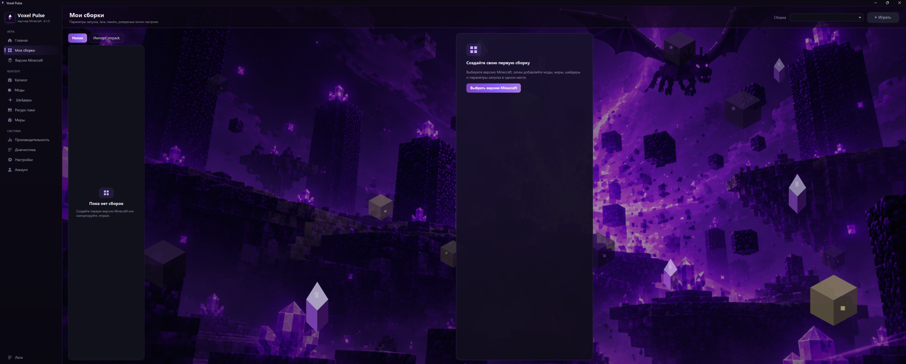
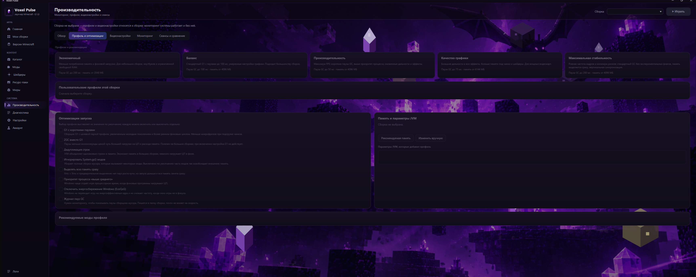

# Voxel Pulse

Independent Minecraft Java Edition launcher and modpack manager.

**In active development.** Voxel Pulse brings together instance management, runtime preparation, Modrinth content, backups and performance configuration.

[Project repository](https://github.com/Naf1Xx/Voxel-Pulse) · [Support](support.html) · [Privacy notice (draft)](privacy.html) · [Terms (draft)](terms.html)

## Explore the interface

## Microsoft sign-in

The launcher is designed to use Microsoft OAuth device code flow. Minecraft API approval and live independent game launch testing are not yet confirmed. A Microsoft account and appropriate Minecraft entitlement are required for authenticated play.

Voxel Pulse is independent and is not affiliated with or endorsed by Microsoft or Mojang Studios.
